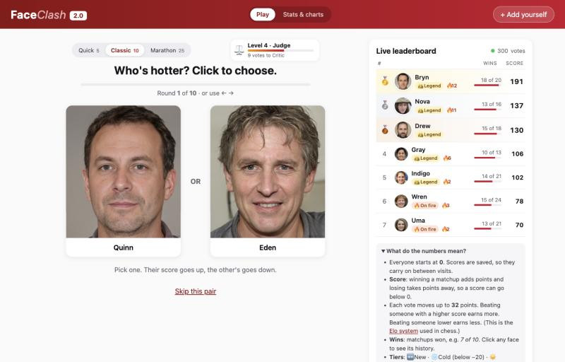
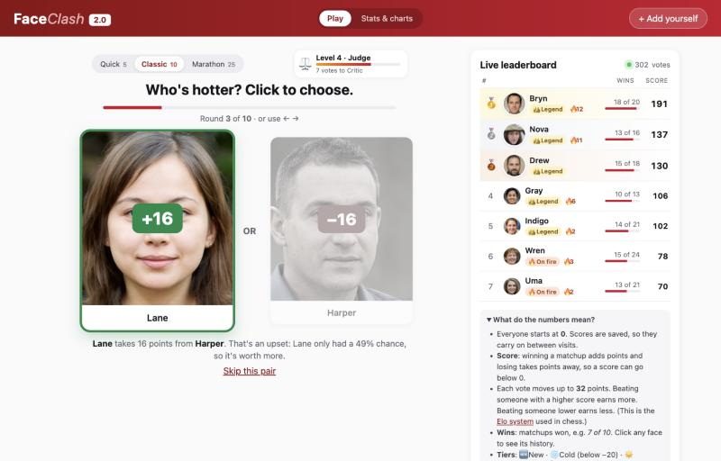
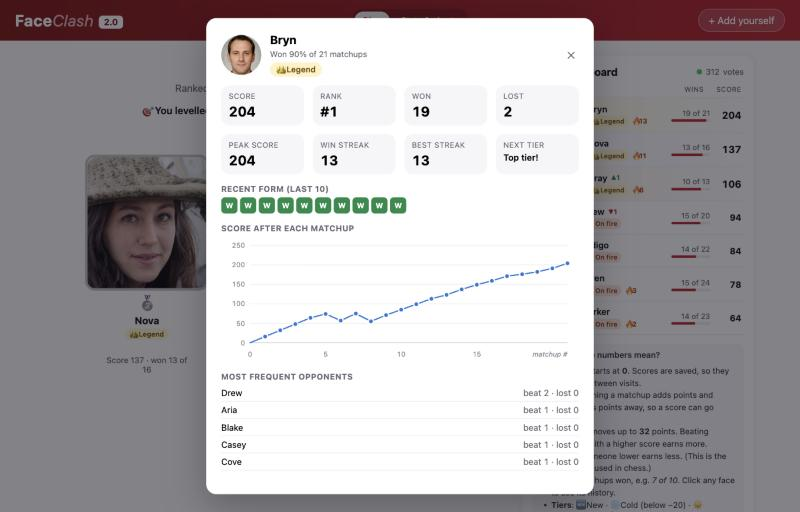
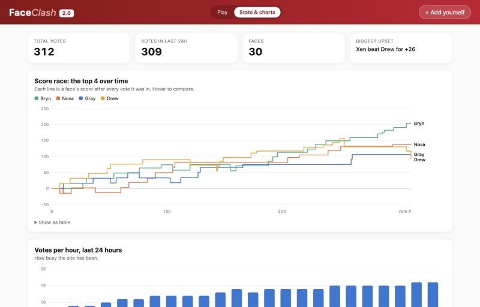
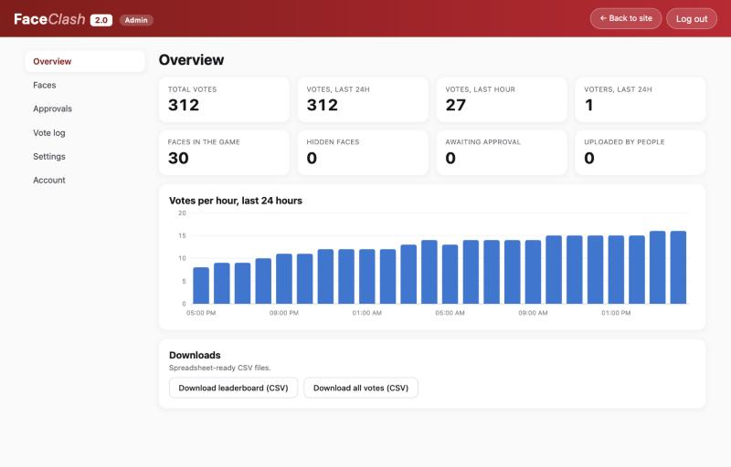
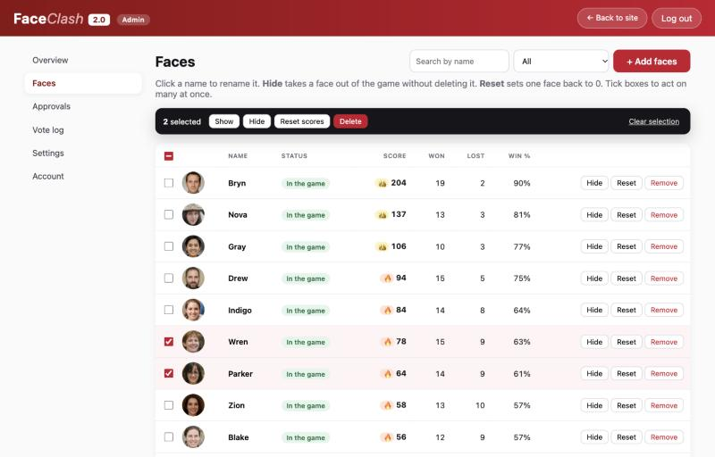
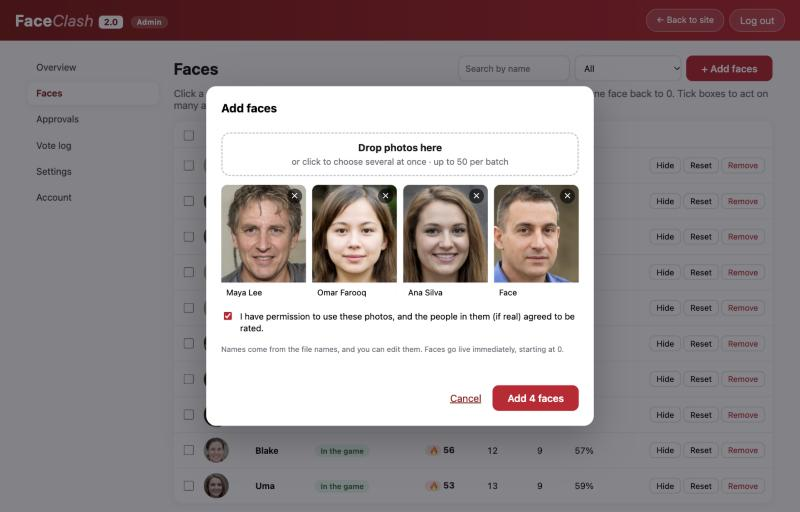
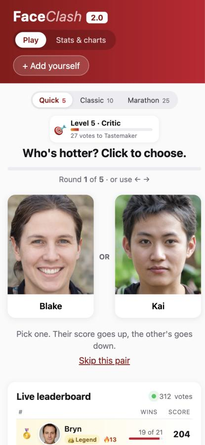

<div align="center">

# FaceClash 2.0

**Two faces. One click. A live, Elo-ranked leaderboard.**

A lightweight "who's hotter?" voting game built with plain PHP, SQLite and vanilla JavaScript: no frameworks, no build step, no external services.




</div>

---

## Contents

- [Features](#features)
- [Screenshots](#screenshots)
- [Tech stack](#tech-stack)
- [Getting started](#getting-started)
- [Deploying to a server](#deploying-to-a-server)
- [How scoring works](#how-scoring-works)
- [Admin dashboard](#admin-dashboard)
- [API reference](#api-reference)
- [Running the tests](#running-the-tests)
- [Project structure](#project-structure)
- [Security & privacy](#security--privacy)
- [Credits](#credits)
- [License](#license)

## Features

**Playing**
- Pick between two faces by clicking or with the ← → keys. Each vote shows how many points moved and why.
- Three game modes: **Quick** (5 rounds), **Classic** (set by the admin) and **Marathon** (25 rounds), followed by a Top 3 podium.
- **Player levels**: ten voter ranks, from 🌱 Newcomer to 👑 Legend, with a progress bar and level-up animation.
- **Smart matchmaking** pairs faces with similar scores and favours faces with few votes, so rankings settle quickly.

**Leaderboard & stats**
- A live leaderboard that refreshes every 3 seconds, with medals, rank-change arrows, win-rate bars and 🔥 win streaks.
- **Face tiers**: 🆕 New · ❄️ Cold · ☀️ Warming up · 🌶️ Hot · 🔥 On fire · 👑 Legend.
- A **Stats & charts** page with a score race for the top 4, votes per hour, and summary numbers. Charts are dependency-free SVG with hover tooltips and table views.
- A profile for every face showing score history, peak score, current and best streak, recent form, and most frequent opponents.

**Uploads**
- Visitors can add themselves by drag-and-drop, file browse or paste, with an explicit consent checkbox.
- Each uploader gets a private key that lets them remove their photo at any time, with no account needed.
- Optional approval queue before uploads go live.

**Admin dashboard**
- Overview, a faces manager (search, filter, pagination, rename, hide, reset, delete), **bulk actions**, and multi-photo upload.
- Approval queue, vote log, CSV export, site settings and password change.

## Screenshots

| Voting | Results |
|---|---|
|  |  |
| **Face profile** | **Stats & charts** |
|  |  |
| **Admin overview** | **Admin faces manager** |
|  |  |
| **Admin multi-photo upload** | **Mobile** |
|  |  |

<sub>Screenshots use demo voting data. All built-in faces are AI-generated and do not belong to real people.</sub>

## Tech stack

| Layer | Technology |
|---|---|
| Backend | **PHP 8.1+**: a single JSON API (`api.php`) with sessions for admin login |
| Database | **SQLite 3** via PDO (WAL mode). The file is created automatically on first request |
| Frontend | **HTML5, CSS3, vanilla JavaScript (ES2020)**, with no frameworks and no build step |
| Charts | Hand-written SVG line and bar charts (`charts.js`) with a colour-blind-safe palette |
| Ranking | **Elo rating system** (K = 32), the same maths used to rank chess players |
| Images | Client-side crop and compress with `<canvas>`, server-side JPEG validation |
| Tests | A self-contained PHP test runner (`tests/run_tests.php`) with 51 end-to-end checks |

## Getting started

### Requirements

- **PHP 8.1 or newer** with the `pdo_sqlite` extension (enabled by default in most installs)
- Git

Check your PHP:

```bash
php -v
php -m | grep -i pdo_sqlite
```

<details>
<summary>Installing PHP</summary>

- **macOS:** `brew install php`
- **Ubuntu / Debian:** `sudo apt install php-cli php-sqlite3`
- **Windows:** download from [windows.php.net](https://windows.php.net/download/) and enable `extension=pdo_sqlite` in `php.ini`, or use [XAMPP](https://www.apachefriends.org/)

</details>

### 1. Download

```bash
git clone https://github.com/mohakamran/faceclash.git
cd faceclash
```

Or click **Code → Download ZIP** on GitHub and unzip it.

### 2. Set an admin password

```bash
php scripts/set_admin_password.php
```

You'll be asked for a password (at least 8 characters). Only a bcrypt hash is stored, in `data/admin.json`.

### 3. Run it

```bash
php -S localhost:8765 router.php
```

Open **http://localhost:8765** to play and **http://localhost:8765/admin.html** for the dashboard.

That's it. The database and the 30 built-in faces are set up automatically on the first page load.

### Optional: download a fresh set of faces

The repo ships with 30 AI-generated faces in `faces/`. To replace them with new ones:

```bash
rm -rf faces && scripts/fetch_faces.sh 30
```

## Deploying to a server

FaceClash runs on any host with PHP 8.1+ and SQLite, including cheap shared hosting.

1. Upload the project folder to your web root.
2. Make sure the web server can write to `data/` and `uploads/`:
   ```bash
   chmod 775 data uploads
   ```
3. Set the admin password over SSH with `php scripts/set_admin_password.php`. If you don't have SSH, generate `data/admin.json` locally and upload it.
4. **Block private folders.** On Apache, the included `.htaccess` files in `data/`, `scripts/`, `tests/` and `uploads/` already do this. On **Nginx**, add:
   ```nginx
   location ~ ^/(data|scripts|tests)/ { deny all; }
   location = /db.php     { deny all; }
   location = /router.php { deny all; }
   location ~ ^/uploads/.*\.php$ { deny all; }
   ```
5. Serve the site over **HTTPS**. The session cookie is marked `Secure` automatically when HTTPS is detected.

## How scoring works

- Every face **starts at 0**. Scores are stored in SQLite and persist across visits.
- Each vote is a match between two faces. The winner takes points from the loser, so the total always stays at zero.
- How many points move depends on how surprising the result was:

  ```
  expected = 1 / (1 + 10^((loserScore − winnerScore) / 400))
  points   = 32 × (1 − expected)
  ```

  An even match moves 16 points. Beating a much higher-ranked face moves up to 32, and beating a much lower one moves only a few.
- **Face tiers** come from the score: ❄️ Cold (below −20) · ☀️ Warming up · 🌶️ Hot (20+) · 🔥 On fire (50+) · 👑 Legend (100+).
- **Player levels** count how many votes you've cast in your browser: Newcomer → Scout → Spotter → Judge → Critic → Tastemaker → Expert → Connoisseur → Icon → Legend.

## Admin dashboard

Go to `/admin.html` and log in with the password you set.

| Section | What you can do |
|---|---|
| **Overview** | Live totals (votes, voters, faces, pending uploads), a votes-per-hour chart and CSV downloads |
| **Faces** | Search, filter (in game, hidden, pending, visitor, admin, built-in), paginate (All, 5, 10, 20, 30), rename inline, hide or show, reset one face, delete |
| **Bulk actions** | Tick rows, or "Select all matching", then Approve, Show, Hide, Reset scores or Delete |
| **Add faces** | Drag in up to 50 photos at once. Names are filled in from file names and can be edited, and the faces go live immediately |
| **Approvals** | Approve or reject visitor uploads when "Approve uploads first" is on |
| **Vote log** | Every vote with the time, the scores after it and an anonymised voter ID |
| **Settings** | Rounds per game, allow uploads, approve uploads first, and a danger zone for resetting all scores |
| **Account** | Change the admin password |

## API reference

All endpoints live at `api.php?action=…` and return JSON. Every `POST` must send `Content-Type: application/json`.

<details>
<summary>Public endpoints</summary>

| Method | Action | Description |
|---|---|---|
| GET | `config` | Public settings: `roundsPerGame`, `uploadsOpen`, `requireApproval` |
| GET | `pair` | Two faces to compare (remembered in the session) |
| POST | `vote` | `{ winner: id }`: applies Elo to the current pair |
| GET | `board` | Leaderboard with tiers and streaks, plus recent votes |
| GET | `stats` | Chart data: top-4 score history, votes per hour, totals |
| GET | `person&id=N` | One face's history, peak, streaks, form and rivals |
| POST | `add` | `{ name, consent: true, image }`: visitor upload (JPEG data URL). Returns a private `deleteToken` |
| POST | `remove` | `{ id, token }`: an uploader removes their own photo |

</details>

<details>
<summary>Admin endpoints (require an admin session)</summary>

| Method | Action | Description |
|---|---|---|
| GET | `admin_status` | Whether the current session is an admin |
| POST | `admin_login` / `admin_logout` | `{ password }` |
| GET | `admin_overview` | Dashboard totals and settings |
| GET | `admin_faces` | Every face, with status and source |
| POST | `admin_add` | `{ name, image, rights: true }`: the face goes live immediately |
| POST | `admin_update_face` | `{ id, name?, status? }` |
| POST | `admin_reset_face` | `{ id }` |
| POST | `admin_delete` | `{ id }` |
| POST | `admin_bulk` | `{ ids: [...], op: "remove" \| "hide" \| "show" \| "approve" \| "reset" }` |
| GET | `admin_votes[&before=id]` | Vote log, 50 per page |
| GET | `admin_export&type=leaderboard\|votes` | CSV download |
| POST | `admin_settings` | `{ roundsPerGame?, uploadsOpen?, requireApproval? }` |
| POST | `admin_password` | `{ current, new }` |
| POST | `reset` | All scores back to 0 and vote history cleared |

</details>

## Running the tests

```bash
php tests/run_tests.php
```

The runner copies the app into a temporary folder with its own database and a random admin password, starts PHP's built-in server on a free port, and runs 51 checks. They cover voting and Elo maths, throttling, stats, uploads and consent, removal tokens, admin access control, settings, bulk actions, CSV export and reset. **Your real `data/` and `uploads/` are never touched.**

```
FaceClash 2.0 tests (isolated copy on port 63827)

Voting & Elo
  ✔ pair returns two different faces
  ✔ even match moves 16 points
  ✔ same pair cannot be voted twice
  ...
51 passed
```

## Project structure

```
faceclash/
├── index.html          # Game: voting, leaderboard, stats, profiles, uploads
├── app.js              # Game logic, live leaderboard, levels, modes
├── admin.html          # Admin dashboard
├── admin.js            # Dashboard logic: faces, bulk, uploads, settings
├── charts.js           # Dependency-free SVG line and bar charts
├── style.css           # All styles (responsive)
├── api.php             # JSON API
├── db.php              # SQLite setup, migrations, tiers, helpers
├── router.php          # Router for PHP's built-in server (blocks private files)
├── faces/              # 30 built-in AI-generated faces
├── scripts/
│   ├── set_admin_password.php
│   └── fetch_faces.sh  # Download a fresh set of AI faces
├── tests/run_tests.php # End-to-end test runner
├── docs/screenshots/   # Images used in this README
├── data/               # Created at runtime: database, admin hash (git-ignored)
└── uploads/            # Created at runtime: uploaded photos (git-ignored)
```

## Security & privacy

- **Consent first.** Visitor uploads require a consent checkbox, and admin uploads require a permission checkbox. Uploaders can delete their own photo at any time.
- **Votes can't be forged.** A vote is only accepted for the pair the server just showed that session, and only once.
- **Rate limits:** at most one vote per 300 ms per session and 600 votes per hour per network. IP addresses are stored only as salted hashes.
- **Admin protection:** passwords are hashed with bcrypt, failed logins are slowed down, session IDs are regenerated on login, and cookies are `HttpOnly` and `SameSite=Strict`.
- **Uploads are validated** as real JPEGs on the server and stored under random names, and PHP execution is blocked in `uploads/`.
- **Private files** (`data/`, `scripts/`, `tests/`, `db.php`) are blocked by `router.php` and `.htaccess`.
- **CSV exports** neutralise spreadsheet formulas in names.

## Credits

- The built-in faces were generated by AI at [thispersondoesnotexist.com](https://thispersondoesnotexist.com). They are not photos of real people.
- The ranking uses the [Elo rating system](https://en.wikipedia.org/wiki/Elo_rating_system).

## License

[MIT](LICENSE) © 2026 Muhammad Kamran
